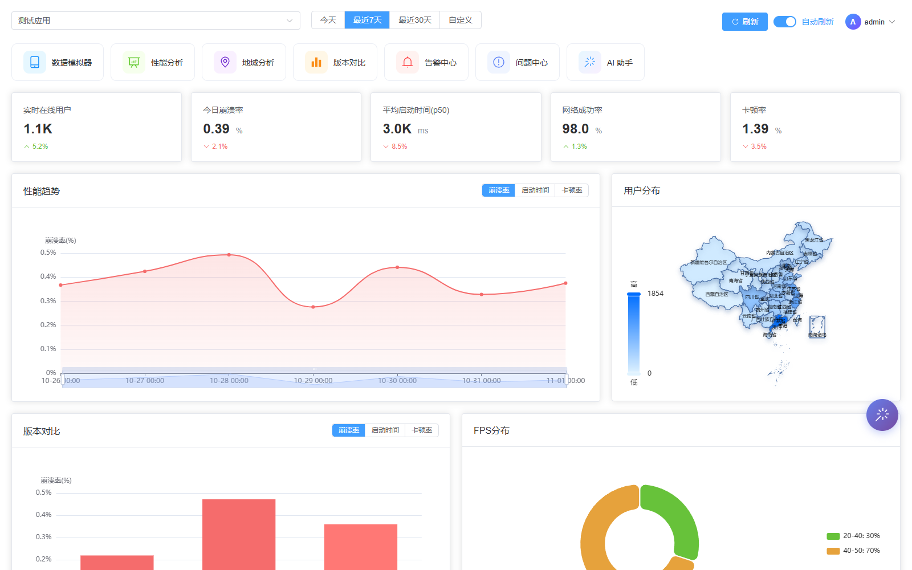
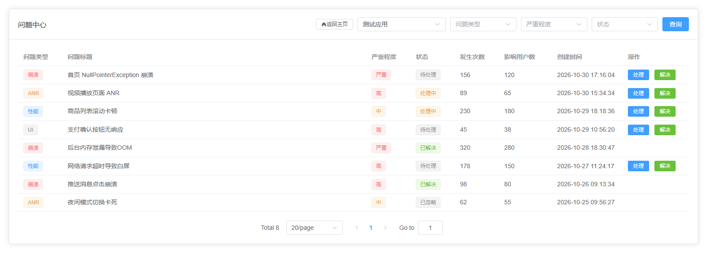
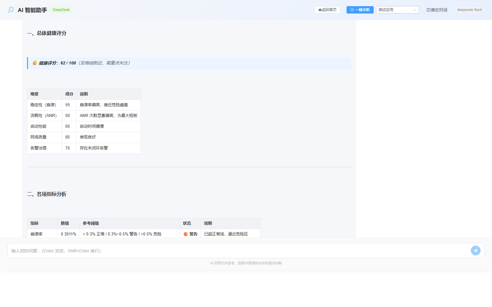

# 智能移动端应用性能监控与优化平台

> **Mobile APM** — 一站式移动应用性能监控、智能告警与 AI 辅助分析平台

[](https://spring.io/projects/spring-boot)
[](https://vuejs.org/)
[](https://www.mysql.com/)
[](LICENSE)

**在线演示：** [http://43.142.66.143](http://43.142.66.143) （演示账号 `admin` / `123456789`，普通用户 `demo` / `123456`）

## 界面预览

| 性能仪表盘（实时 KPI · 趋势 · 地理分布 · 版本对比 · FPS） | 问题中心（崩溃 / ANR / 性能 / UI 分类追踪） |
|:---:|:---:|
| [](docs/screenshots/01-dashboard.png) | [](docs/screenshots/02-issue.png) |

**AI 智能诊断**（一键拉取真实性能数据，由 DeepSeek 生成健康评分、指标对标与优化建议）

[](docs/screenshots/03-ai-assistant.png)

---

## 目录

- [界面预览](#界面预览)
- [项目简介](#项目简介)
- [核心功能](#核心功能)
- [技术栈](#技术栈)
- [系统架构](#系统架构)
- [项目结构](#项目结构)
- [快速开始](#快速开始)
- [访问地址](#访问地址)
- [后端 API 接口](#后端-api-接口)
- [前端页面路由](#前端页面路由)
- [常用命令速查](#常用命令速查)
- [数据库表结构](#数据库表结构)
- [数据聚合与告警链路](#数据聚合与告警链路)
- [开发注意事项](#开发注意事项)

---

## 项目简介

本平台提供完整的移动应用全链路监控解决方案，涵盖**实时性能监控**、**智能告警引擎**、**问题追踪**、**数据分析可视化**及 **AI 智能辅助分析**等核心能力。支持多应用管理，帮助开发者快速定位和解决性能瓶颈。

## 核心功能

| 模块 | 功能说明 |
|------|---------|
| **性能仪表盘** | 实时 KPI 指标、趋势折线图、地理分布地图、版本分布饼图、FPS 分布图、崩溃/ANR/性能问题概览 |
| **问题中心** | 崩溃 / ANR / 性能异常 / UI 问题分类追踪，含设备信息与堆栈详情，支持处理与解决流转 |
| **告警中心** | 多级告警规则引擎，状态流转 `FIRING → ACKNOWLEDGED → RESOLVED → CLOSED` |
| **智能分析** | 性能分析、地区分析、版本对比三大图表分析页 |
| **AI 智能助手** | 基于 DeepSeek 大模型，提供性能异常诊断与优化建议 |
| **实时推送** | 基于 WebSocket (STOMP/SockJS) 的告警实时推送 |
| **应用管理** | 多应用注册、SDK 配置分发（ADMIN） |
| **数据模拟器** | 内置采集模拟器，批量生成性能/崩溃/ANR 等测试数据（ADMIN） |
| **个人中心** | 修改个人资料与密码（内置 ADMIN 账号不可改密） |
| **用户系统** | JWT 认证、注册/登录/刷新令牌、角色权限（ADMIN / USER） |
| **定时数据聚合** | 上报时增量聚合 + 每小时增量 / 每日全量定时重算，汇总结果直接驱动告警检测 |
| **自动演示数据** | 后端启动时自动生成最近 7 天演示数据与演示告警规则，无需手动维护 |
| **移动端适配** | 仪表盘 / 分析 / 告警 / 问题等页面支持手机浏览器：栅格自动堆叠、KPI 两列、图表全宽、表格可横向滚动 |

---

## 技术栈

| 层级 | 技术 | 版本 |
|------|------|------|
| **后端框架** | Spring Boot | 3.1.5 |
| **Java** | JDK | 17 |
| **ORM** | MyBatis-Flex | 1.7.8 |
| **数据库** | MySQL | 8.0 |
| **JDBC 驱动** | MySQL Connector/J | 8.2.0 |
| **缓存** | Redis | 7.x |
| **认证** | Spring Security + JWT (jjwt) | 0.11.5 |
| **API 文档** | Knife4j (SpringDoc) | 4.1.0 |
| **AI 引擎** | DeepSeek API | deepseek-chat |
| **实时推送** | WebSocket + STOMP (SockJS) | - |
| **前端框架** | Vue 3 | 3.3+ |
| **构建工具** | Vite | 5.0 |
| **UI 组件库** | Element Plus | 2.3+ |
| **图表库** | ECharts + vue-echarts | 5.4+ / 6.6+ |
| **状态管理** | Pinia | 2.1+ |
| **HTTP 客户端** | Axios | 1.4+ |
| **实时通信** | @stomp/stompjs + sockjs-client | 7.x / 1.6 |
| **代码检查** | ESLint + eslint-plugin-vue | 8.x / 9.x |
| **测试** | Vitest | 3.x |

> **RabbitMQ** 已彻底移除：`spring-boot-starter-amqp` 依赖、`spring.rabbitmq` 配置与 `RabbitMqHealthCheck` 均已删除，后端不使用消息队列。

---

## 系统架构

```
┌──────────────────────────────────────────────────────┐
│                    用户浏览器                         │
│             Vue3 + Element Plus + ECharts            │
│               (http://localhost:3000)                 │
└──────────────────────┬───────────────────────────────┘
                       │ HTTP (Vite Proxy /api → :8080)
                       │ WebSocket (SockJS /ws-stomp)
                       ▼
              ┌────────────────┐
              │  Spring Boot   │
              │    后端 API     │
              │  http://localhost:8080  (context-path=/api)
              └───┬───────────┬──┐
                  │           │  │
       ┌──────────┘           └───────────┐
       ▼                                  ▼
 ┌───────────┐   ┌────────────┐   ┌──────────────┐
 │  MySQL 8  │   │   Redis 7  │   │DeepSeek AI   │
 │ mobile_apm│   │ 缓存/Session│   │ 智能分析引擎  │
 └───────────┘   └────────────┘   └──────────────┘
```

---

## 项目结构

```
kaifa/
│
├── backend/                              # 后端 Spring Boot 项目
│   ├── src/main/java/com/monitor/
│   │   ├── MonitorApplication.java       # 启动类
│   │   ├── common/                       # 公共模块
│   │   │   ├── GlobalExceptionHandler    # 全局异常处理 (BizException / 参数校验 / 兜底 500)
│   │   │   ├── BizException              # 业务异常
│   │   │   └── Result<T>                 # 统一响应封装 {code, data, message}
│   │   ├── config/                       # 配置类
│   │   │   ├── WebSecurityConfig         # Spring Security 安全配置
│   │   │   ├── WebSocketConfig           # WebSocket / STOMP 实时推送配置
│   │   │   ├── RedisConfig               # Redis 序列化配置
│   │   │   ├── SwaggerConfig / SpringDocFixConfig  # Knife4j API 文档配置
│   │   │   ├── AsyncConfig               # 异步线程池
│   │   │   ├── AdminPasswordInitializer  # 管理员账户初始化(仅首次创建时使用默认密码)
│   │   │   ├── AlertRuleConfig           # 告警规则预配置
│   │   │   ├── NotificationConfig        # 通知渠道配置
│   │   │   ├── DemoDataInitializer       # ★ 启动时自动生成最近7天演示数据
│   │   │   ├── DemoUserInitializer       # ★ 启动时创建演示普通用户 demo/123456
│   │   │   ├── RedisHealthCheck          # Redis 健康检查
│   │   │   └── FilterConfig              # 禁用 JWT 过滤器的全局重复注册
│   │   ├── controller/                   # 控制器层 (详见下方 API 列表)
│   │   │   ├── AuthController / AiController            # 前缀 /auth, /ai
│   │   │   ├── ApplicationController / DashboardController / PerformanceDataController
│   │   │   ├── IssueController / AlertController        # 前缀 /v1/*
│   │   ├── service/ + service/impl/      # 服务接口 + 实现 (含 RealTimePushService、NotificationService)
│   │   ├── dao/                          # MyBatis-Flex Mapper 接口
│   │   ├── repository/                   # 额外 Repository (MyBatis-Flex Mapper)
│   │   ├── entity/                       # 数据库实体 (7个) + enums/ 枚举 (5个)
│   │   ├── dto/ vo/                      # 数据传输对象 / 视图对象
│   │   ├── handler/                      # MyBatis TypeHandler (JsonNodeTypeHandler)
│   │   ├── security/                     # JwtAuthenticationFilter / JwtAuthenticationEntryPoint / UserDetailsServiceImpl
│   │   └── util/                         # 工具类 (JwtUtil)
│   ├── src/main/resources/
│   │   ├── application.yml               # 主配置
│   │   ├── application-dev.yml           # 开发环境配置
│   │   ├── application.properties        # 基础属性 (激活 dev profile)
│   │   ├── mapper/                       # MyBatis XML 映射文件
│   │   └── db/                           # 数据库脚本
│   │       ├── V1__Create_tables.sql          # 建表 (自动执行: spring.sql.init.schema-locations)
│   │       ├── V1.0.2__Insert_Admin_User.sql  # 管理员用户 (自动执行: data-locations)
│   │       ├── V1.0.3__Add_Role_Field_To_User_Table.sql  # 手动 ALTER 脚本（不会自动执行）
│   │       └── fix_db.sql                # 手动维护脚本（fix_db.bat 引用）
│   │           ⚠️ 文件名是 Flyway 风格，但项目无 Flyway 依赖；
│   │              实际由 Spring 原生 spring.sql.init 加载，仅前两个脚本自动执行
│   └── pom.xml
│
├── frontend/                             # 前端 Vue 3 项目
│   ├── src/
│   │   ├── App.vue / main.js             # 应用入口
│   │   ├── api/                          # API 接口层
│   │   │   ├── request.js                # Axios 封装 (拦截器 / Token / 错误处理)
│   │   │   ├── dashboard.js / alert.js / issue.js / ai.js
│   │   ├── assets/map/china-simple.json  # 中国地图 GeoJSON (34省真实坐标，统一由 @/assets/map 引用)
│   │   ├── router/index.js               # 路由配置 (含登录守卫与角色控制)
│   │   ├── stores/dashboard.js           # Pinia 状态管理
│   │   ├── composables/useWebSocket.js   # WebSocket STOMP 实时推送
│   │   ├── composables/useIsMobile.js    # 响应式判断窄屏（详情页描述列表切单列）
│   │   ├── styles/responsive.css         # 移动端适配基础样式（<768px 断点）
│   │   ├── components/FloatBall.vue      # 悬浮球组件
│   │   ├── __tests__/dashboard.test.js   # Vitest 单元测试 (store 逻辑)
│   │   └── views/
│   │       ├── Login.vue / Register.vue / Simulator.vue / Profile.vue / NotFound.vue
│   │       ├── dashboard/PerformanceDashboard.vue + components/
│   │       │     (KpiCard/TrendChart/GeoChart/VersionChart/FpsChart/AlertTable/IssueTable)
│   │       ├── alert/ AlertCenter.vue, AlertDetail.vue
│   │       ├── issue/ IssueCenter.vue, IssueDetail.vue
│   │       ├── ai/ AiAssistant.vue
│   │       └── analysis/ PerformanceAnalysis.vue, RegionAnalysis.vue, VersionAnalysis.vue
│   ├── vite.config.js                   # Vite 配置 (端口3000, 代理到后端8080)
│   └── package.json
│
├── .env.example                          # 环境变量模板（复制为 .env 后填写）
├── start_all.bat                         # 一键启动全部服务 (Windows)
├── stop_all.bat                          # 一键停止前后端 (Windows)
├── restart_backend.bat                   # 重启后端
├── fix_db.bat                            # 数据库修复快捷脚本
├── reset_pwd.bat                         # 密码重置快捷脚本
├── smoke_test.ps1                        # 接口冒烟测试脚本 (PowerShell)

├── docs/screenshots/                     # README 界面预览截图（仪表盘 / 问题中心 / AI 诊断）
├── reset_admin_pwd.sql                   # 重置管理员密码 (手动脚本)
├── LICENSE                               # MIT 开源协议
└── README.md                             # 本文件
```

---

## 快速开始

### 系统要求

| 组件 | 最低版本 |
|------|---------|
| Node.js | >= 16 |
| Java (JDK) | >= 17 |
| Maven | >= 3.8 |
| MySQL | >= 8.0 |
| Redis | >= 7.0 |

### ⚠️ 首次启动前：配置环境变量

敏感配置（数据库密码、JWT 密钥、AI Key）**已从配置文件中移除**，需通过 `.env` 提供：

```bash
copy .env.example .env      # Windows
# 然后编辑 .env 填入真实值
```

| 变量 | 说明 | 是否必填 |
|------|------|---------|
| `DB_USERNAME` / `DB_PASSWORD` | MySQL 用户名/密码 | ✅ 必填 |
| `JWT_SECRET` | JWT 签名密钥，请使用长随机串 | ✅ 必填 |
| `DEEPSEEK_API_KEY` | DeepSeek API Key | 可选（留空则 AI 功能不可用，其余不受影响） |

> `.env` 已加入 `.gitignore`，不会被提交。
> 后端通过 `spring.config.import` **自动加载**项目根目录的 `.env`，因此 `start_all.bat`、IDE 运行、以及直接 `mvn spring-boot:run` 都无需额外设置环境变量。
> 优先级：**操作系统环境变量 > `.env`**。若两者都缺失，会因 `JWT_SECRET` 占位符无法解析而启动失败（这是刻意的安全设计，不含任何内置默认密钥）。

### 方式一：一键启动（推荐 Windows）

```bash
start_all.bat
```

脚本会自动检测端口、跳过已运行的服务，依次启动：

| 步骤 | 服务 | 端口 | 说明 |
|------|------|------|------|
| 1 | MySQL | 3306 | 未运行时自动 `net start MySQL80` |
| 2 | Redis | 6379 | 未运行时自动拉起本机便携版（**无密码**），失败也不影响核心功能 |
| 3 | 后端 Spring Boot | 8080 | 新窗口运行 `mvn spring-boot:run`，日志 → `backend.log` |
| 4 | 前端 Vite Dev Server | 3000 | 新窗口运行 `npm run dev`，日志 → `frontend.log`，首次自动 `npm install` |

启动完成后会自动打开 http://localhost:3000。

> **注意**
> - Redis 必须以**无密码**方式启动，否则后端连不上缓存（`application.yml` 中 `spring.data.redis.password` 为空）。
> - 后端与前端各自运行在独立窗口（`APM-Backend` / `APM-Frontend`），**关闭对应窗口即可停止服务**。
> - 后端启动时会通过 `DemoDataInitializer` 自动为 `test-app` 生成最近 7 天的演示数据，无需手动执行 SQL。

### 方式二：手动分步启动

#### 1️⃣ 准备依赖

确保 MySQL（3306，库 `mobile_apm`）与 Redis（6379，无密码）已启动。

#### 2️⃣ 启动后端

```bash
cd backend
mvn spring-boot:run
# 或 Windows 下: ..\restart_backend.bat
```

> 后端默认读取 `application-dev.yml`。首次启动会自动建表并写入管理员账号。
> API 文档: http://localhost:8080/swagger-ui.html

#### 3️⃣ 启动前端

```bash
cd frontend
npm install     # 首次运行
npm run dev
```

> 前端运行在 **http://localhost:3000**（`vite.config.js`，`host: 0.0.0.0` 故局域网亦可访问），
> 自动代理 `/api` → `http://localhost:8080/api`，并代理 WebSocket `/ws-stomp`（开启 `ws: true`）。

#### 4️⃣ 登录系统

| 角色 | 用户名 | 密码 |
|------|--------|------|
| 管理员 | `admin` | `123456789` |
| 普通用户（演示） | `demo` | `123456` |
| 普通用户 | 自行注册 | 密码 6-20 位 |

> 登录页提供 **「管理员演示账号」「普通用户演示账号」** 两个按钮，点击后自动填入账号密码并登录。
> 账号 `demo` 由后端 `DemoUserInitializer` 在启动时自动创建（已存在则不覆盖）。

> `AdminPasswordInitializer` 只在**首次启动（admin 账户不存在）**时用默认密码 `123456789` 创建管理员，
> **后续启动不会覆盖已有密码**，你自己改过的密码不会被重置。
> 忘记密码时可执行 `reset_pwd.bat`（或 `mysql < reset_admin_pwd.sql`）重置。

---

## 访问地址

| 服务 | 地址 | 默认账号 |
|------|------|---------|
| **前端应用** | http://localhost:3000 | 见上文 |
| **后端 API** | http://localhost:8080/api/** | JWT Bearer Token |
| **Swagger/Knife4j 文档** | http://localhost:8080/api/swagger-ui.html 或 http://localhost:8080/api/doc.html | - |
| **MySQL** | `localhost:3306`（TCP，非 HTTP） | 见 `.env`（`DB_USERNAME` / `DB_PASSWORD`） |
| **Redis** | `localhost:6379`（TCP，非 HTTP） | 无密码 |

> MySQL 与 Redis 是 **TCP 服务**，不能直接用浏览器打开，需用 MySQL Workbench / DBeaver / `redis-cli` 等客户端连接。

---

## 后端 API 接口

后端 context-path 为 `/api`。完整地址 = `http://localhost:8080/api` + 下表路径。

**无需 `/v1` 前缀的模块：** 认证 `/auth`、AI `/ai`
**带 `/v1` 前缀的模块：** 应用 `/v1/application`、仪表盘 `/v1/dashboard`、性能 `/v1/performance`、问题 `/v1/issue`、告警 `/v1/alert`

> 需鉴权接口请携带 JWT Token（请求头 `Authorization: Bearer <token>`）。
>
> **无需 Token 的接口**：`/auth/login`、`/auth/register`、`/auth/refresh`（改用 `?refreshToken=` 参数）、`/actuator/health`。其余接口均需认证。

### 认证模块 `/auth`

| 方法 | 路径 | 说明 |
|------|------|------|
| POST | `/auth/login` | 登录获取 Token |
| POST | `/auth/register` | 用户注册 |
| POST | `/auth/refresh` | 刷新 Token（请求参数 `?refreshToken=`） |
| POST | `/auth/logout` | 退出登录（需 `Authorization` 头） |
| POST | `/auth/change-password` | 修改当前登录用户密码（需原密码，ADMIN 账号不可修改） |

### 应用管理 `/v1/application`

| 方法 | 路径 | 说明 |
|------|------|------|
| GET | `/v1/application/list` | 获取应用列表 |
| GET | `/v1/application/{id}` | 获取应用详情 |
| POST | `/v1/application` | 创建应用（ADMIN） |
| PUT | `/v1/application/{id}` | 更新应用（ADMIN） |
| DELETE | `/v1/application/{id}` | 删除应用（ADMIN） |

### 仪表盘 `/v1/dashboard`

| 方法 | 路径 | 说明 |
|------|------|------|
| GET | `/v1/dashboard/summary` | 汇总 KPI 指标 |

### 性能数据 `/v1/performance`

| 方法 | 路径 | 说明 |
|------|------|------|
| POST | `/v1/performance/report` | 批量上报性能数据（SDK，一次最多 100 条） |
| GET | `/v1/performance/trend` | 性能趋势数据 |
| GET | `/v1/performance/geo` | 地理分布数据 |
| GET | `/v1/performance/version` | 版本对比数据 |
| GET | `/v1/performance/device` | 设备维度数据（按设备聚合事件/崩溃/ANR/卡顿/平均启动） |
| GET | `/v1/performance/network` | 网络类型维度数据（按 WIFI/4G/5G 聚合） |
| GET | `/v1/performance/fps` | FPS 分布数据 |

### 问题中心 `/v1/issue`

| 方法 | 路径 | 说明 |
|------|------|------|
| GET | `/v1/issue/list` | 问题列表（按 appKey / type / severity / status 筛选） |
| GET | `/v1/issue/{id}` | 问题详情（含设备信息与堆栈） |
| POST | `/v1/issue/{id}/process` | 处理问题（ADMIN） |
| POST | `/v1/issue/{id}/resolve` | 解决问题（ADMIN） |

### 告警中心 `/v1/alert`

| 方法 | 路径 | 说明 |
|------|------|------|
| GET | `/v1/alert/list` | 告警列表（按 severity / status 筛选） |
| GET | `/v1/alert/{id}` | 告警详情 |
| POST | `/v1/alert/{id}/acknowledge` | 确认告警（ADMIN） |
| POST | `/v1/alert/{id}/resolve` | 解决告警（ADMIN） |

### AI 智能助手 `/ai`

| 方法 | 路径 | 说明 |
|------|------|------|
| POST | `/ai/chat` | 发送问题，获取 AI 分析建议 |
| POST | `/ai/diagnose` | 一键诊断应用性能问题，生成结构化报告 |

> 完整 API 文档启动后访问：`http://localhost:8080/swagger-ui.html`

---

## 前端页面路由

| 路径 | 页面 | 权限 |
|------|------|------|
| `/login` | 登录页 | 公开 |
| `/register` | 注册页 | 公开 |
| `/dashboard` | 性能仪表盘（首页） | ADMIN, USER |
| `/simulator` | 数据采集模拟器 | ADMIN |
| `/profile` | 个人中心（修改资料/密码） | ADMIN, USER |
| `/404` | 404 页面 | 公开 |
| `/alert` | 告警中心 | ADMIN, USER |
| `/alert/detail/:id` | 告警详情 | ADMIN, USER |
| `/issue` | 问题中心 | ADMIN |
| `/issue/detail/:id` | 问题详情 | ADMIN |
| `/ai-assistant` | AI 智能助手 | ADMIN, USER |
| `/analysis/performance` | 性能分析 | ADMIN, USER |
| `/analysis/region` | 地区分析 | ADMIN |
| `/analysis/version` | 版本对比 | ADMIN |

> 路由守卫在 `frontend/src/router/index.js`：未登录自动跳转 `/login`；无权限跳回 `/dashboard`。

---

## 常用命令速查

```bash
# === 后端 ===
cd backend && mvn compile -q                # 编译
cd backend && mvn spring-boot:run           # 启动 (默认 application-dev.yml)
restart_backend.bat                         # Windows 快捷重启后端

# === 前端 ===
cd frontend && npm install                  # 安装依赖
cd frontend && npm run dev                  # 开发模式 (http://localhost:3000)
cd frontend && npm run build                # 生产构建
cd frontend && npm test                     # 运行单元测试 (Vitest)
cd frontend && npm run lint                 # 代码检查 (ESLint, 0 error 0 warning)

# === 一键启动/停止全部服务 ===
start_all.bat                               # Windows 一键启动 (MySQL/Redis/后端/前端)
stop_all.bat                                # Windows 一键停止 (按端口精确终止，不影响其他 java/node 进程)

# === 数据库操作 ===
mysql -u root -p mobile_apm < reset_admin_pwd.sql      # SQL方式重置管理员密码（交互式输入密码）
reset_pwd.bat                               # Windows 快捷重置密码
fix_db.bat                                  # Windows 快捷修复数据库
```

---

## 数据库表结构

| 表名 | 对应实体 | 关键字段 |
|------|---------|---------|
| `application` | `Application` | app_key(唯一), name, package_name, platform(ANDROID/IOS), owner_id, status |
| `user` | `User` | username, password(Bcrypt), real_name, email, role(ADMIN/USER), status |
| `performance_summary` | `PerformanceSummary` | app_key, date, hour(NULL=按天), active_users, new_users, session_count, crash_count, lag_count, network_request_count, network_failure_count, province |
| `performance_data` | `PerformanceDataNew` | app_key, device_id, session_id, event_type(startup/crash/anr/fps/memory/network), event_time, event_data(JSON), version_code, os_version, network_type, province |
| `issue` | `Issue` | app_key, type(CRASH/ANR/PERFORMANCE/UI), severity(1低/2中/3高/4严重), status(0待处理/1处理中/2已解决/3已忽略), device_info(JSON), stack_trace |
| `alert_instance` | `AlertInstance` | app_key, rule_id, rule_name, metric, severity(LOW/MEDIUM/HIGH/CRITICAL), status(FIRING/ACKNOWLEDGED/RESOLVED/CLOSED) |
| `alert_rule` | `AlertRule` | app_key, name, rule_type(THRESHOLD/TREND/YOY/MOM/ANOMALY), metric, condition, threshold, severity, enabled, notification_channels(JSON) |
| `user_application` | **无实体** | user_id, app_key, role（预留表，当前未使用） |
| `sdk_config` | **无实体** | app_key, config_key, config(JSON)（预留表，当前未使用） |
| `alert_record` | **无实体**（仅 `AlertRecordVO`） | 告警历史记录，通过原生 SQL / VO 查询 |

> 所有业务表均含 `deleted` 逻辑删除字段（MyBatis-Flex 全局配置 `logic-delete-field: deleted`），以及 `create_time` / `update_time`。

---

## 数据聚合与告警链路

对应任务指导书**功能点 20（定时数据聚合）**，并打通「上报 → 聚合 → 告警」全链路。

### 链路流程

```
移动端 / 模拟器上报           异步增量聚合                   告警检测
POST /v1/performance/report ─▶ performance_summary ─▶ 读取当天汇总构造指标快照
        │                      （按 日期+省份+版本 分桶）        │
        │                                                      ▼
        └──▶ performance_data（原始明细）           匹配 alert_rule（enabled=1）
                        ▲                                      │
                        │                                      ▼
             定时重算（先删后插，幂等）              AlertRuleEngine 评估
            每小时第5分钟 / 每日01:30               ─▶ alert_instance + 通知 + WebSocket 推送
```

### 聚合策略

| 触发方式 | 入口 | 说明 |
|---------|------|------|
| **上报时增量** | `PerformanceDataServiceImpl#processDataAggregation` | 按「日期 + 省份 + 版本」分桶，已存在汇总行则累加，否则插入。同时维护 `province/app_version` 均为 NULL 的**全国总览行**，供仪表盘 KPI 与告警指标快照读取 |
| **每小时增量** | `DataAggregationScheduler#aggregateTodayHourly`（`0 5 * * * ?`） | 重算当天，修正增量累加的统计偏差 |
| **每日全量** | `DataAggregationScheduler#aggregateYesterdayDaily`（`0 30 1 * * ?`） | 凌晨重算昨天全天，保证最终数据准确 |

定时重算采用**「先删后插」**的幂等方式（`DELETE` 当天 `hour IS NULL` 的汇总行后重新 `INSERT`），重复执行不会产生重复数据。

> **演示应用豁免**：`test-app` 的汇总数据由 `DemoDataInitializer` 直接生成（并非由原始明细推导），若对其执行重算会把演示数据覆盖成明细量的真实值，导致仪表盘数字骤降，因此**定时任务跳过该应用**；该应用在上报时的增量聚合仍然生效。

### 告警检测

上报并聚合完成后，`checkAlerts` 会：

1. 查询该应用已启用的规则（`alert_rule.enabled = 1 AND deleted = 0`）；
2. 基于当天全国汇总行计算指标快照：`crashRate / lagRate / anrRate / networkSuccessRate / startupTime / cpuUsage / memoryUsage`；
3. 同一规则存在未结束告警（`FIRING / ACKNOWLEDGED`）时跳过，避免告警风暴；
4. 命中后由 `AlertRuleEngine` 创建告警实例、发送通知并通过 WebSocket 实时推送。

后端启动时会为 `test-app` 自动初始化 6 条演示规则（崩溃率、ANR 率、启动耗时、CPU、内存、网络成功率），**仅在该应用尚无任何规则时写入**，不会覆盖用户自定义规则。崩溃率阈值设为 `> 0.3%`（演示数据当天约 0.37%），因此上报一次数据即可看到告警产生，便于验证链路。

### 手动验证

```bash
# 1. 登录获取 Token
curl -X POST http://localhost:8080/api/auth/login \
  -H "Content-Type: application/json" \
  -d '{"username":"admin","password":"123456789"}'

# 2. 上报一条崩溃数据（触发聚合与告警检测）
curl -X POST http://localhost:8080/api/v1/performance/report \
  -H "Authorization: Bearer <token>" -H "Content-Type: application/json" \
  -d '{"appKey":"test-app","data":[{"eventType":"APP_CRASH","eventTime":"2026-09-24T10:00:00","deviceId":"d1","sessionId":"s1","data":{"reason":"NPE"},"extras":{"province":"广东"}}]}'
```

随后可在告警中心看到新增的 `FIRING` 告警，后端日志会出现 `数据聚合完成` 与 `实时推送告警`。

---

## 开发注意事项

- **后端 context-path** 为 `/api`，前端通过 Vite proxy (`/api` → `http://localhost:8080/api`) 自动转发。
- **前端端口** 固定为 **3000**（`vite.config.js`），不是 Vite 默认的 5173。
- **Axios 拦截器** 已解包响应体：`response = { code, data, message }`，取数据用 `response.data`。
- **JWT Token** 有效期 24 小时，Refresh Token 7 天。
- **角色权限**：
  - **USER 可见**：仪表盘、告警中心、AI 助手、性能分析、个人中心。
  - **ADMIN 额外可见**：问题中心、地区分析、版本对比、数据模拟器、应用管理；且问题处理/解决、告警确认/解决、应用增删改等写操作接口均需 ADMIN。
- **演示数据自动初始化**：`DemoDataInitializer` 实现 `CommandLineRunner`，每次后端启动自动删除旧 test-app 数据并重新生成最近 7 天演示数据（每日汇总 + 省份分布）。
- **数据库脚本**：项目**未引入 Flyway**，尽管文件名是 `V1__`/`V1.0.2__` 风格，实际由 Spring 原生 `spring.sql.init` 执行，且**只自动执行前两个**；`V1.0.3__Add_Role_Field_To_User_Table.sql` 与 `fix_db.sql` 需手动执行（或用 `fix_db.bat`）。
- **管理员密码**：`AdminPasswordInitializer` **仅在首次初始化时**（admin 不存在，或仍是建库脚本写入的初始 hash）设置默认密码 `123456789`；**已改过密码则不再覆盖**。忘记密码时执行 `reset_pwd.bat`。
- **容错设计**：告警/问题查询在表未初始化时返回空数组而非 500 错误。
- **Redis**：已启用（`spring.data.redis.enabled=true`，注意前缀是 `spring.data.redis` 不是 `spring.redis`），带健康检查，连接失败不影响核心功能。
- **健康检查**：`/api/actuator/health` 在 `WebSecurityConfig` 中已 `permitAll()`，无需 Token 即可访问。
- **告警状态**：`alert_instance.status` 支持四态 `FIRING → ACKNOWLEDGED → RESOLVED → CLOSED`；`severity` 为 `LOW/MEDIUM/HIGH/CRITICAL`。
- **WebSocket 实时推送**：SockJS 端点 `/ws-stomp`（Vite 已代理，开启 `ws: true`）。客户端可订阅：
  - `/topic/alerts` — 新告警
  - `/topic/alerts/status` — 告警状态变更
  - `/topic/notifications` — 系统通知
  - `/topic/kpi/{appKey}` — KPI 实时更新
  - Broker 前缀 `/topic`、`/queue`；客户端发送前缀 `/app`。
- **RabbitMQ**：依赖与配置已全部移除。
- **AI 功能**：`application.yml` **不内置**任何 Key，需通过环境变量 `DEEPSEEK_API_KEY` 提供；未配置时 AI 功能降级返回提示，其余功能不受影响。
- **单元测试**：前端 `frontend/src/__tests__/dashboard.test.js` 使用 Vitest + Pinia，执行 `npm test`（或 `npx vitest run`）；测试环境为 `node`（项目未安装 jsdom，现有用例不依赖 DOM）。
- **代码检查**：已补充 `.eslintrc.cjs`，执行 `npm run lint`（当前 0 error 0 warning）。

---

## License

本项目基于 [MIT License](LICENSE) 开源，© 2026 yichenzui
